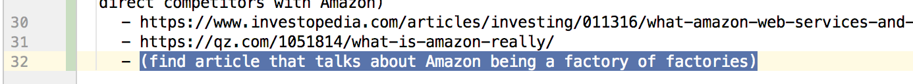
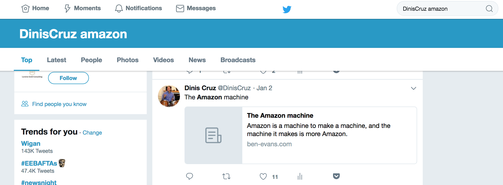

# Generation Z Developers: the drafts

*What the 2018 repository held but the published book left out: 6 draft chapters and 89 outlines, as they were left, from https://github.com/DinisCruz/Book_Generation_Z_Developer at 61886444f. Not part of v1.0.0; the second edition's raw material.*

# Introduction

## STEM Tech Stack

*Draft, 312 words, 1.introduction/stem-tech-stack.md.*

One of the frequent comments I get when talking about the topics in this book is _"I like the concepts but I'm not a developer/programmer!"_, implying that they don't have to learn how to code in order to be effective professionals in their area. Given the impact of technology of all parts of society and industries (after all, ['Every company is a technology company'](https://blogs.thomsonreuters.com/answerson/all-companies-are-technology-companies-now/) these [ days](https://www.forbes.com/sites/forbestechcouncil/2017/01/23/why-every-company-is-a-technology-company/)) this is a very career limiting move, and even more worryingly, it is limiting

This means that all professionals need to know how to code, more specifically the ones in _STEM_ (Science, Technology, Engineering and Maths) sector.

### Mapping the tech stack per generation

In order to represent the evolution of the tech stack (or toolkit), I decided to map out which technologies where used by era and Generation

The use of Tech Stack is borrowed from the software development process where it represents a [_combination of programming languages, tools and frameworks that the developers use to create web and mobile applications_](https://hackernoon.com/how-to-pick-the-right-web-technology-stack-for-your-product-f6d94440af2f)

### Gen X
*[Figure missing from the 2018 repository: `STEM-tech-stack_001.png` was never generated from its PlantUML source.]*

Here are the main components

- Brain
- Pen
- Paper
- Scientific Calculator

### Gen Y

*[Figure missing from the 2018 repository: `STEM-tech-stack_002.png` was never generated from its PlantUML source.]*

- **Brain**:
- **Pen and Paper**: ...
- **~~Scientific Calculator~~**: ...
- **Spreadsheets**: ...
- **Computer**: ...
- **Mobile**: ...
- **Internet**: ...
- **Email**: ...
- **Data Center**: ...

### Gen Z

*[Figure missing from the 2018 repository: `STEM-tech-stack_003.png` was never generated from its PlantUML source.]*

- **Brain**: ...
- **Pen and Paper**: ...
- **AI and LM**: AI (Artificial Intelligence) and ML (Machine Learning) ...
- **~~Scientific Calculator~~**: ...
- **~~Spreadsheets~~**: ...
- **~~Computer~~ and ~~Mobile~~**: ... merge and eventually disappear
- **~~Internet~~**: ... disappears since it becomes a commodity where everything is connected to it
- **~~Email~~**: ...
- **~~Data Center~~**: ...

(to add to diagram)
- **voice**

# MVP for Gen Z Dev

## TDD (Test-Driven Development)

*Outline, 318 words, 2.mvp-for-gen-z-dev/draft/tdd.md.*

**Topics to cover and ideas**

 - the most coverage you get, the more changes you are happy to make, the better the code is because you have the confidence to make the hundreds of small changes that the only way to create a high quality and scalable application
 - be a craftsman
 - explain history
 - key challenges
 - why the TDD community created dogma and lost the plot
 - if you don't have 100% code coverage, what are those bits of code not covered by tests? (what happens if that code changes)
 - everything should be tested
    - history of a site that went down for hours because of a one char (pipe) change in a nginx config file

 ** bugs as features**

  - replicate bugs first (before trying to fix them)
  - link my slideshare presentation on this topic

### BDD (Behaviour-Driven Development)

**Topics to cover and ideas**

 - what is it
 - great evolution
 - where is works
    - when it works well it is amazing
 - great connection with business
 - can create bit white elaphants (like like Selenium)
    - requires quite a lot of discipline and investment to keep up to date

 - explain Gherkin language

 ### FDD (Feedback-Driven Development)

 **Topics to cover and ideas**

 - real-time feedback in IDE (REPLs)
    - this is key to learn
    - run code as you lift your fingers or press save
 - show screenshot of my typical dev environment
 - wallabyjs
    - great example of what this UI needs to be
    - incredible how it has not be copied into all IDEs (as far as I can tell only NCrunch has the same features)
 - all code changes (except refactoring) should require a test change
    - see http://pitest.org/
    - see chaos engineering
 - every developer does tests all time
    - the question is how repeatable, scalable, mesuable those tests are
    - and how much context switching occurs

 - the FDD applies to much more than just coding (see chapter on "Inventing on Principle") it is also related to how we learn

  - Power of Feedback loops

## AWS

*Outline, 320 words, 2.mvp-for-gen-z-dev/draft/aws.md.*

AWS is Amazon's Cloud offering and is spectacular success story

**Topics to cover and ideas**

 - What is it
 - History
 - How it made Amazon the powerhouse it is today
 - Key technologies
    - route 53
    - EC2
    - S3
    - Container Service
    - Lambda
 - why the cloud revolution happened (why were they so successful)
    - the failure of sysops data centers to modernise
        - no scalability, failed to modernise, no shared resources, tool expensive, no shared learnings, insecure
    - the cost of installing one server (£2k to £5k in large companies)
    - vs the cost of spinning up entire racks (programmatically)
 - AWS today is as complex as an OS (windows or linux). It can only be managed in a programmatic way. But today the testing capabilities of AWS and other cloud providers is still very low (namely on end-to-end tests and configurations changes)

 - If you don't have an AWS or Azure or Google Cloud account, what are you wait for? All have really generous free tiers that allow you to try a large number of their capabilities for free. And as long as you shut down everything everyday, the costs shouldn't be that high.

 - AWS is what happens when a tech team becomes so good that is able to provide those services to 3rd parties
    - think about this, Amazon.co.uk is getting their IT and development costs paid by 3rd party companies (some direct competitors with Amazon)
    - https://www.investopedia.com/articles/investing/011316/what-amazon-web-services-and-why-it-so-successful.asp
    - https://qz.com/1051814/what-is-amazon-really/
    - Amazon in 2011 was shipping to production every 10s (http://assets.en.oreilly.com/1/event/60/Velocity%20Culture%20Presentation.pdf)

**The amazon machine**
 - how amazon become one of the best development houses in the world
 - https://www.ben-evans.com/benedictevans/2017/12/12/the-amazon-machine (great article that talks about the Amazon machine, which is the real power behind it)

## Continuous Integration

*Outline, 79 words, 2.mvp-for-gen-z-dev/draft/continuous-integration.md.*

**Topics to cover and ideas**

 - why it matters
 - how it works
 - key technologies
 - build your CI pipeline now
   - from your laptop to deployed site (push to production in seconds)
         - Hugo is a great way to see this in action
   - key paradigms shifts occur when one see this in action
   - Give example of EC2 environment with:
       - vulnerable website
       - ZAP (to generate attack traffic)
       - ELK (to visualise traffic)
       - Write security tests that execute against site
 - compare with CD (Continuous Delivery)O

## Electron

*Outline, 37 words, 2.mvp-for-gen-z-dev/draft/electron.md.*

...

**Topics to cover and ideas**

 - https://en.wikipedia.org/wiki/Electron_(software_framework)
 - important to learn and experience the creation of desktop applications
 - node on the backend and chromium in the frontend
 - major desktop applications written in it

## GitHub Flow

*Outline, 30 words, 2.mvp-for-gen-z-dev/draft/github-flow.md.*

...

---

**Topics to cover and ideas**

 - Understand what is it
 - Mention history about it
 - Mention GitLab Flow
 - Learn how to do Forks, Commits and Pull Requests
 - How to think about branches

## IOT (Internet of Things)

*Outline, 228 words, 2.mvp-for-gen-z-dev/draft/iot.md.*

...

**Topics to cover and ideas**

 - why it is big
 - what it means for programmers
 - massive job opportunities
 - the power of software vs hardware
 - it is all about code
 - security
    - most IOT vendors don't understand much about modern development practices and security
    - [shodan](https://www.shodan.io/) google for IoT (find tons of vulnerable devices)
    - IoT worms (example of power grid exploit)
        - the ones that generated billions of requests and Tb of data
    - hacking baby cameras and dools

  - developers have a big responsibility here
  - risk's mappings of reality could be a great way to get vendors to do the right thing
  - Electricity analogy (take current devices and add AI)
  - it is already amongst us (controled by Siri and Alexa)
    - what happens when these bots start to clash to one another (see[my 2020 vision, AI Edition](https://www.linkedin.com/pulse/my-2020-vision-ai-edition-taras-novak) )
  - Arduino
    - What is it, why is it important, how much it costs
    - spend money on new IoT devices in kickstarter, for example on [Arduino](https://www.kickstarter.com/discover/advanced?ref=nav_search&term=arduino) related projects (even better invent something and start a kickstarter campain, if that is successful, you will be highly employable)
    - get an arduino (or raspberry pi) and create your own IoT appliance for your home ( this is a great story to go on your CV)

## linux

*Outline, 138 words, 2.mvp-for-gen-z-dev/draft/linux.md.*

Linux is the Operating System that is used by billions of computers, servers, mobiles and IOT devices.

**Topics to cover and ideas**

 - linux history (it all started by Linus Torvalds inspired by a MINIX system)
    - mention some of Linus views

 - [Linux patch submitted by an 4 year old](https://git.kernel.org/pub/scm/linux/kernel/git/torvalds/linux.git/commit/?id=690b0543a813b0ecfc51b0374c0ce6c8275435f0)
 - most complex software in the world
    - git was created to manage the linux code development
 - you need to learn it, how to install kernel drivers, how to hack it, how to rebuilt it
 - power of raspberry pi is that it gives you a linux environment for you to play with
 - Mac is 'just about' linux under the hood (same heritage), but with a better UI and integrations
 - How it started [images/linus-linux-post.png]

## Minecraft

*Outline, 13 words, 2.mvp-for-gen-z-dev/draft/minecraft.md.*

...

**Topics to cover and ideas**

 
 - learn how to program it 
 - Microsoft bought it

## raspberry-pi

*Outline, 112 words, 2.mvp-for-gen-z-dev/draft/raspberry-pi.md.*

**Topics to cover and ideas**

 - why was it created
    - https://en.wikipedia.org/wiki/Raspberry_Pi_Foundation
    - https://www.makeuseof.com/tag/raspberry-pi-creditcard-sized-arm-computer-25/
 - use a raspberry PI to connect to a hardware (get one of the starter kits (add link). Make a led blink, create a mobile phone, etc..
 - connected to maker movement and IOT world
 - article [Raspberry Pi device will 'reboot computing in schools'](https://www.theguardian.com/education/2012/jan/09/raspberry-pi-computer-revolutionise-computing-schools)
 - Create your own computer (buy the parts and create one from scratch: board, cpu, memory, disk ,graphics card)
    - if you are into gaming, this could be your game machine

## StackOverflow

*Outline, 59 words, 2.mvp-for-gen-z-dev/draft/stack-overflow.md.*

...

**Topics to cover and ideas**

 - https://stackoverflow.com
 - Amazing knowledge base (stared with development but it has expanded on all sorts of topics)
 - don't underestimate how hard it is to build something that easy to use
 - great case study on how to build a community
 - your SO ranking should be on your CV
 - Jobs https://stackoverflow.com/jobs

## Wikipedia

*Outline, 70 words, 2.mvp-for-gen-z-dev/draft/wikipedia.md.*

...

**Topics to cover and ideas**

 - Why does it work
 - What is stopping you from contributing
 - Go and create a page now and make some edits
 - understand the power of peer review
 - understand why it works and why the quality of content is so high
    - also know its limitations and the areas where it doesn't work so well
 - what is wikipedia business model, the need to have independent revenues streams

# Technologies

## Blockchain

*Outline, 53 words, 3.technologies/draft/blockchain.md.*

...

**Topics to cover and ideas**

 - Key concept to understand
 - Power of Ledges
 - Massive hype at the moment , but it will change a lot of industries
    - due to its ability to allow trust to occur between un-trusted parties
 - Not just bitcoin
    - amazing to think that we still don't know who created bitcoin

## Browser Automation

*Outline, 82 words, 3.technologies/draft/browser-automation.md.*

...

**Topics to cover and ideas**

 - code the browser
    - write electron (or selenium) scripts
    - write code on Inspector window (Dev Tools)
 - amazing feeling when you actually automate something as simple as an login screen
 - most companies have not solved how to do this effectively (for example to automatically test for site performance and security issues/problems)
 - understand the power of automating the browser
 - ability to create an API from any website (worse case scenario is to automate the browser)
 - understand how bots work

## Dopamine

*Outline, 184 words, 3.technologies/draft/dopamine.md.*

Do you know what Dopamine is? Do you know why mobile phone notifications are so addictive?

- https://en.wikipedia.org/wiki/Dopamine

---

**Topics to cover and ideas**

 - detox from your phone
 - detox from notifications
 - stop notifications
 - related to the Zone and Deep work concepts
 - Your ability to perform uninterrupted and focused work is one of your most important skills and a massive competitive advantage. This is how the best code is produced
 - you are addicted to your phone. Mobile phones 'attention grabbing activities' are the new smoking
 (they affect the brain)
 - "why do you have the huge to check your phone when you hear an interruption". it is like a thread has started in your brain that wont complete until you check it.
 - the problem is that these dopamine interruptions make you lose context (and lose the 'zone')

Notes [Why We're All Addicted to Texts, Twitter and Google](https://www.psychologytoday.com/blog/brain-wise/201209/why-were-all-addicted-texts-twitter-and-google)

## DSL

*Outline, 73 words, 3.technologies/draft/dsl.md.*

DSL (Domain Specific Language)

...

**Topics to cover and ideas**

 - what are they
 - why are they so important
 - abstractions layers
   - make the code as simple as posible
   - .net extension methods are a great compiler trick to achieve very clean domain(ish) languages with strongly type
   - why support for static compilation and code complete is very important (groovy and javascript problem)
 - refactor the code to make it aligned with the bsuiness functions it is execution

## Ngrok

*Outline, 75 words, 3.technologies/draft/ngrok.md.*

...

**Topics to cover and ideas**

  - Explain how it works
  - Great example of streams 
  - Can be easily created in NodeJs using Streams (or nc.exe)
  - Shows how easy it is to ex-filtrate data from an company
  - Great example of innovation (and to provide 1 service that does something well correctly, with quickly evolving solid features)
    - developer with great understanding(and philosophy) of customer service and support
  - Task: Build an NGrok like service using AWS Lambdas

## Node JS

*Outline, 62 words, 3.technologies/draft/node-js.md.*

...

**Topics to cover and ideas**

 - why NodeJS took the world by storm
 - the power of async code
 - generating 20k requests with a couple lines of code
 - coding at the speed of thought (and type)
 - node history (based on chrome's V8)
 - the node forking incident (io.js)
    - why it was so important
    - why java could had done with a fork like that

## R (language)

*Outline, 26 words, 3.technologies/draft/r-language.md.*

...

**Topics to cover and ideas**

 - https://en.wikipedia.org/wiki/R_(programming_language)
 - important language to learn 
 - builtin in REPL
 - great way to process and visualise data

## Scratch

*Outline, 29 words, 3.technologies/draft/scratch.md.*

...

**Topics to cover and ideas**

 - explain history
 - great way to learning programming concepts
 - create a couple games (like pac man or alien invaders)
 - You can program Scratch in Javascript

## Streams

*Outline, 50 words, 3.technologies/draft/streams.md.*

...

**Topics to cover and ideas**

  - Key concept in programming. Paradigm shift when you see data as an stream
    - sequence of transformations until you reach the end-state
  - One of the reasons Node JS scaled so much
  - gulp example
  - AWS Logs transformation in Lambda using gz streams (from gz to gz)

## Web Proxies

*Outline, 25 words, 3.technologies/draft/web-proxies.md.*

...

**Topics to cover and ideas**

 - Fiddler, Zap Proxy
 - Key to understand how the web works
 - don't just use them, program on top of them

# Concepts

## Gamification

*Draft, 127 words, 5.concepts/gamification.md.*

- Game Theory
 - add Ted talk on it
 - You (Gen Z) see this everyday in your digital interactions (the badges, the nudgets, the rewards, the streaks)
    - you are being manipulated into being hooked into the apps your used
    - you are the product, not the client
    - there are teams that their job is to find more ways to hook you (and your time) into their platform
        - supported by lots of Science and Research (into how we consciously and unconsciously behave)
    - understand when you are being played (or brains are not designed to control the stimulus we receive)
 - the power of nudges and FOMO (Fear Of Missing Out)
 - that said, as a developer this is a really powerful skil to have
    - when developing gamification systems quick feedback loops are critcal

## Agile and Kanban

*Outline, 159 words, 5.concepts/agile-and-kanban.md.*

**Topics to cover and ideas**

 - history
 - why it worked
 - agile manifesto
    - https://www.agilealliance.org/agile101/the-agile-manifesto/
        - Individuals and interactions over processes and tools
        - Working software over comprehensive documentation
        - Customer collaboration over contract negotiation
        - Responding to change over following a plan

 - [Software Craftsmanship](http://manifesto.softwarecraftsmanship.org/)
    - Not only working software             , but also well-crafted software
    - Not only responding to change         , but also steadily adding value
    - Not only individuals and interactions , but also a community of professionals
    - Not only customer collaboration       , but also productive partnerships

 - Anton cords
 - explain concepts (with diagrams)
 - how agile become dogma and created environments where agile teams where not agile at all
    - processes become more important than understanding why something was being created in the first place, to much effort was put on estimates, to much focus was placed on what could be done in 2 weeks
 - Scrumbam is a nice alternative

 - [The Mythical Man-Month](https://en.wikipedia.org/wiki/The_Mythical_Man-Month)

## Amazon Press Release

*Outline, 26 words, 5.concepts/amazon-press-releases.md.*

...

**Topics to cover and ideas**

 - great concept
 - describe the definition of success
 - use FAQs to explain details
 - works for main pieces of work and smaller projects

## Change Engineering

*Outline, 12 words, 5.concepts/change-engineering.md.*

...

**Topics to cover and ideas**

 - what is it
 - see my slideshare presentation

## Changes

*Outline, 120 words, 5.concepts/changes.md.*

**Topics to cover and ideas**

 - Change is the only constant
 - Enjoy lose briefs (they are an opportunity to refactor those briefs into something that you are good at)
 - put yourself in places where you are being highly productive while learning a lot.
    - find the sweet spot where you are adding a lot of value
 - view problems as oportunities (which can be broken down into smaller problems and tasks)

 - [Who Moved My Cheese: An Amazing Way to Deal with Change in Your Work and in Your Life](https://www.amazon.co.uk/Who-Moved-My-Cheese-Amazing/dp/0091816971)
 - [Our Iceberg is Melting: Changing and Succeeding Under Any Conditions](https://www.amazon.co.uk/Our-Iceberg-Melting-Succeeding-Conditions/dp/1509830111/)

## Chaos Engineering

*Outline, 645 words, 5.concepts/chaos-engineering.md.*

**Topics to cover and ideas**

 - Great concept (from 2017)
 - Security has been doing this for ages
 - Add references to site and best posts
 - focus on resilient systems
 - need to understand and visualize what is going on
    - a massive problem with micro-services (and any services/monolith) based application is vibility into what is going on (and even just getting good graphs is the first step, just ask anybody who has deployed AppDynamics)
 - integrate this concept with the SRE's 'Error Budget'
 - expand on the concept of 'Steady state' (and write tests for it)
    - how we want tests to replicate it

(from Miles)
- **Chaos Engineering is Experimentation and Testing** : In part of the definition of chaos engineering it is useful to state that the technique is made up of experimentation, to explore and discover weaknesses, and testing, to validate that a known weakness is in fact overcome.
- **Chaos Engineering and Resilience Engineering** - People practicing Chaos Engineering are part of the Resilience Engineering capability of an organisation. Chaos Engineering is a key discipline for learning and validating a system's robustness in the face of turbulent conditions, and it provides a pre-emptive motivation to learn and improve as part of the overall sociotechnical system's resiliency.
- **Make sure to reference the Principles of Chaos** - For me, this is the authoritative definition for Chaos Engineering: http://principlesofchaos.org/ I'd also argue any sufficiently complex system, distributed or not, can gain from pre-emptively exploring and discovering sociotechnical system weaknesses.
- **Game Days and Automated Chaos Experiments part of a Chaos Engineers toolbox** - Game Days are manually executed chaos experiments. Automated Chaos Experiments and Tests are where you'd like to execute your experiments and tests continuously (Continuous Chaos) and so automation enables that without distracting everyone from their other valuable work.
- **Chaos Engineering and the overall Software Development Lifecycle** - Chaos experimentation can begin even before anything has arrived in production by exploring the potential for system weaknesses in a solution, mentally or actually running Game Day experiments. It is a great architecture, design and organisational exploration technique to find weaknesses early.
- **Continuous Chaos (Engineering)** - Chaos experimentation and testing is often executed as frequently as possible as the turbulent conditions of the target (production) system are often sufficiently dynamic that weaknesses can surface and be discovered by a chaos experiment at any time. This also informs the relationship between CI/CD and continuous chaos. While there is value in adding chaos testing and experimentation into the CI/CD pipeline, "delivery" is only one cause of conditions that you might want to trigger chaos experiments to explore. Traffic changes, infrastructure failure, platform conditions; the system is under the stress of transient turbulent conditions between releases and so often it is desirable to execute chaos on an entirely different cadence to delivery, often more frequently, to explore these interim conditions as well.
- **Chaos Engineering and Observability** - Chaos Engineering frequently encourages better system observability, and takes advantage of that greater observability, so the two techniques are mutual forcing-factors for improvement.

**references**:

 - [The Language of Chaos Experiments in Chaos Toolkit](https://medium.com/chaos-toolkit/the-language-of-chaos-experiments-in-chaos-toolkit-bd55a5c04057)
 - https://github.com/chaostoolkit , http://chaostoolkit.org/ , http://chaostoolkit.org/faq/
 - http://www.oreilly.com/webops-perf/free/chaos-engineering.csp book
 - [Chaos Engineering: Why the Label Matters](https://medium.com/russmiles/chaos-engineering-why-the-label-matters-35ddbb974fa5)
 - [Chaos Engineering for the Business](https://medium.com/russmiles/chaos-engineering-for-the-business-17b723f26361) introduces great concept "Limited scope, continuous, disaster recovery"
 - [Are you ready for Chaos Engineering?](https://medium.com/russmiles/are-you-ready-for-chaos-engineering-59b859091281)
 - [Chaos engineering paradigm](https://www.codibly.com/2017/05/chaos-engineering-paradigm/)
 - https://github.com/Netflix/chaosmonkey
 - [From resilient to antifragile - Chaos Engineering Primer DevSecCon](https://www.slideshare.net/sbodiu/from-resilient-to-antifragile-chaos-engineering-primer-devseccon)

## CI Testing

*Outline, 97 words, 5.concepts/CI-Testing.md.*

...

**Topics to cover and ideas**

 - CI - Continuous Integration
 - if you make changes and a test doesn't break, you are making random changes (and have no way to know if those changes are still active tomorrow)
 - Pushing security to the left
 - Test your pipeline
 - "config changes can be more dangerous than code changes"
    - find source (quote from [AWS re:Invent 2017: Performing Chaos at Netflix Scale (DEV334)](https://www.youtube.com/watch?v=LaKGx0dAUlo) )
    - the reason this is true is because we don't test out config changes (at least the same way we test our code)

## Deadlines

*Outline, 243 words, 5.concepts/deadlines.md.*

...

**Topics to cover and ideas**

 - understand that many deadlines are just indications of an arbitrary point in the future when somebody would like to see something done
  - usually deadlines are set without a realistic understanding of the original problem, the resources available and what is the definition of success
 - Being able to hit deadlines is really important in business and life. The better you are at doing this, the more you will be trusted to deliver. 
    - What is important is to understand what are deadlines that can be missed, what are deadlines that are completely unrealistic and what are deadlines that HAVE to be meet (usually the ones connected to a specific event that cannot be moved)
    - unrealistic deadlines can cause a lot of damage and prevent a lot of 'important but not urgent' activities (for example not improving the test environment because there isn't time before the next deadline). There are moments where there is a false economy of just focusing on short/medium term activities
 - Solution is to break the problem into small milestones and be flexible (I prefer Kanban to Agile, with Scrumban not a bad alternative) 
 - Developers are the ones that actually have the real power to do something about meeting the deadlines, since they are the ones that will actually do the work
 - One of the reasons Agile doesn't work very well is due to the amount of guess work that happens in the sprint planning

## Design

*Outline, 153 words, 5.concepts/design.md.*

...

**Topics to cover and ideas**

 - explain what it is
 - Steve Jobs and Jon Ive on Design
 - It's about everything
 - 'Design of everyday things' book
 - Design is not about how things look, it is about how they work
 - Microsoft approach to design (story about how for J.Ive change is not a desirable goal, but a side effect of good design)
 - with good design, evolution feel natural and the current status quo quickly feels out of date
 - attention of detail , making it work
 - Simple is very hard (you know it is right when there is nothing to add and remove (without severely affecting the meaning))
 - 'I don't have time to send you a short letter so I'm going to send a long one' 
 - constant refactoring is how we get to good design
    - speed of iteration , beats quality of design (and ironically the speed of iteration will create a more quality outcome)

## DevOps

*Outline, 47 words, 5.concepts/devops.md.*

...

**Topics to cover and ideas**

 - Applying development techniques and technologies to Operations
 - 'Congratulations, you now own/manage a Data Center'
 - DevOps is the evolution of deployment/operations scripts
 - SecDevOps is about adding security to this pipeline and introducing security controls/checks earlier in the development life cycle

## Facts

*Outline, 134 words, 5.concepts/facts.md.*

...

**Data-driven decisions**

---

**Topics to cover and ideas**

 - be data and facts driven
 - science up your arguments (be intellectually curious)
 - check your sources
 - understand the agenda of who is talking to you
 - don't trust what is on the media namely when it is selling fear (after all if it is on the media it is because it is rare)
 - FUD (Fear Uncertainty and Doubt) - Used to be used a lot in the technology sector
 - we are living in challenging times which and it is important to understand that facts and solid science are how we need to think about problems and solutions.
   - not to say that we need to have 100% facts and assurance before decisions are made, but it is important to try to have 'fact based decisions' as much as possible

## Feedback loops

*Outline, 130 words, 5.concepts/feedback-loops.md.*

...

**Topics to cover and ideas**

 - key to create scalable workflows. it is all about effectiveness. 
 - Positive reinforcement, adjust to navigation
 - explain using feedback loops from control systems and engineering
 - TDD is a gigantic feedback loop 
 - Bret Victor's inventing on principle (https://vimeo.com/36579366) is all about feedback loops
 - not about just 'giving feedback' . the key for feedback loops is that the input will affect the output which will affect the input (good example are how a driver uses the driving wheel in a car)
 - used in music (to create special electric guitar sounds) 
 - one interesting challenge is how to measure it
 - I think I have a really good instinct for how feedback loops can exist in business and development 
- exponential growth can happen easily in an feedback loop

## Functional Programming

*Outline, 150 words, 5.concepts/funtional-programming.md.*

...

**Topics to cover and ideas**

 - explain how it works and the power of it
 - examples in Node
 - dangers of creating hard to read and debug code
    - I've seen cases where code exists that nobody really understands how it works (in Scala environments)
        - this is a security risk
        - developers though they were the problem (problem was function that was too complex)
        - it is not because you can that you should
        - code readability and maintainability (by the ones that have to maintain the code, not by the one who wrote it) is a big factor in the quality, value and risk of a piece of code
        - another situation is the ability to not create a full list of urls/endpoints (when function programming is used for handling web-requests)
 - when functions are objects
 - that said, when funtional programing is well used it can produce code that is super elegant and efficient

## GDPR

*Outline, 38 words, 5.concepts/gdpr.md.*

**Topics to cover and ideas**

 - Know your rights. What does it mean for you
 - History of privacy
    - [The Right to Curate an Identity](https://pbx-group-security.com/blog/2017/12/04/the-right-to-curate-an-identity/)

## graphs

*Outline, 36 words, 5.concepts/graphs.md.*

...

**Topics to cover and ideas**

 - See my presentation on Graphs
 - Graphs are everywhere
 - I've been thinking in graphs for years
 - very hard paradigm shift to make
 - requires an ability to think in nodes and edges

## Inventing on Principle

*Outline, 38 words, 5.concepts/inventing-on-principle.md.*

...

---

**Topics to cover and ideas**

 - Bret Victor's inventing on principle (https://vimeo.com/36579366)
 - (add transcription reference) <- print this and read it
 - https://en.wikipedia.org/wiki/Light_Table_(software) http://lighttable.com/ , was inspired by this presentation

## Karma Points

*Outline, 38 words, 5.concepts/karma-points.md.*

**Topics to cover and ideas**

 - "Luck is when oportunity meets the prepared"
 - "make their day" - do this for everybody you work with a collaborate
 - never waste an oportunity to help others, to share knowledge and to create connections

## Legacy Applications

*Outline, 68 words, 5.concepts/legacy-applications.md.*

...

**Topics to cover and ideas**

 - Why they happen
 - The code you are writing today will be legacy tomorrow
 - SecDevOps Legacy - and the opportunity of legacy applications (and why it might be a good idea to work on them)
    - best features: "no new features", "very low expectations of changes", "changes are supposed to be hard", "lots of low-hanging-fruit for refactoring"
    - add link and references to this presentation

## Micro-Services

*Outline, 65 words, 5.concepts/micro-services.md.*

...

**Topics to cover and ideas**

 - explain concepts
 - where they work great
 - Swagger.io
 - problem of understanding how they work together
 - move from a 'blob of code' (the monolith app) into a 'large blog' (the constlation of Micro-services that nobody really has a good understanding of all moving parts and inter-dependencies)
    - this is where Chaos Monkey is a great tool to understand side effects

## Netflix Culture

*Outline, 69 words, 5.concepts/netflix-culture.md.*

Read this https://jobs.netflix.com/culture

Here are their core concepts

- Encourage independent decision-making by employees
- Share information openly, broadly and deliberately
- Are extraordinarily candid with each other
- Keep only our highly effective people
- Avoid rules

The best companies are (or will be) following these concepts, not because its 'cool' but because it makes companies more productive, more nimble and more profitable.

---

**Topics to cover and ideas**

 -

## Pair Programming

*Outline, 136 words, 5.concepts/pair-programming.md.*

...

---

**Topics to cover and ideas**

 - https://en.wikipedia.org/wiki/Pair_programming
 - idea that pair programming is not optimal at the moment
 - When I code in a 'real-time coding environment' I am pair programming with myself
 - a much more interesting pair programing model is one where programmer A codes and programmer B writes the test
    - this is a situation where we actually want the more experienced programmer to be writing the code, since for code to scale we want 'coding excellence as BAU'
    - the more powerful and effective code the code written by the less experienced developer, the more scalable and effective the current development environment is
    - specially important, given the current skills shortage with developers and the companies preference to use an XYZ budget to hire 2x less experienced developers vs 1x more experience developers

## Recursive Functions

*Outline, 31 words, 5.concepts/recursive-functions.md.*

...

---

**Topics to cover and ideas**

 - explain what they are
 - how power for symplicity
 - show dangers
 - the visitor pattern
 - vulnerabilities created by it (find SSL CA vuln presented by moxi at BH)

## REPL

*Outline, 38 words, 5.concepts/repl.md.*

...

**Topics to cover and ideas**

 - explain concept: Read Execute Print Loop
 - how O2 Platform did this really well
 - concept still not very well understood and used
    - some languages have added this to their core workflows (Scala for example)

## Serverless

*Outline, 219 words, 5.concepts/serverless.md.*

...

---

**Topics to cover and ideas**

 - latest industry fad, but important development
 - important to understand why is it gaining momentum
 - important to understand the limitations
 - another example of the failure of Techops to innovate
 - the path to 'Serverless'
 - How AWS Lambda changed the paradigm
    - big example of how it can work in enterprise enviroments
    - lots of powerful side applications (for example creating AWS WAF rules)
        - Writing AWS WAF rules is a skill that would get you hired! (for example dynamically blocking IPs)
 - serverless doesn't mean 'no servers'
    - of course that there is a server, just that the app abstraction goes up another level (it lots of cases it is an function)
    - this will be successfully because it is massively cost effective (story of the crazy cost reductions and performance gains from moving to a lambda based architecture)
    - when you look at how much process and memory (in aggregate) is actually used in by apps in dev, qa and production, you will see that the amount of waste and over-provisioning is huge (i.e. resources not used)
    - once we add more scalable and dynamic micro-services architectures and applications that are able to 'self-degragade' their features based on load (and other factors like security), we will have a very powerful, resilient, available and secure application environment.
    - mention kubeless

## Spotify Model

*Outline, 46 words, 5.concepts/draft/spotify-model.md.*

...

**Topics to cover and ideas**

 - Tribes and Squads
 - Important to understand how it works
 - When implemented correctly can bring focus and break a lot of inefficiencies 
 - Business understands the concept and in some cases even adopts it 
 - Note that Spotify does not use the Spotify model :)

## SRE (Site Reliability Engineering )

*Outline, 44 words, 5.concepts/sre.md.*

...

**Topics to cover and ideas**

 - Amazing concept and thining from Google
 - How Google's run production sites
 - There are jobs today to be SREs (with big demand in the industry)
 - This is very connected to the concept of 'You build it, you own it'

## Strong vs weak types

*Outline, 34 words, 5.concepts/strong-vs-weak-types.md.*

...

---

**Topics to cover and ideas**

 - https://en.wikipedia.org/wiki/Strong_and_weak_typing
 - what are they, and examples of both
 - where each is good at, where each has problems
 - the power of IDEs (on each type)

# Your CV

## leanpub

*Draft, 103 words, 7.your-cv/leanpub.md.*

- reference leanpub manifest
 - more than just a website
 - great culture
 - use it to publish your books
 - direct connection with your readers
 - story: how I built this book using leanpub
 - story: all the other leanpub books that I have not completed
 - pricing strategy: is it better
    a) less readers by all are paid
    b) lots more readers: and a significant percentage is not paying
 - publish early and often
    - email readers on new versions
 - ability to get a print-ready pdf (who can be used to print on amazon.com or amazon.co.uk)
    - there are print on demand books, with no cost to you

## Personal Brand

*Outline, 92 words, 7.your-cv/personal-brand.md.*

**Topics to cover and ideas**

 - What is your personal brand
 - What is your online avatar (how do you want people to think about you)
 - How can you be found
 - Who are you
 - What do you represent
 - What is your voice
 - Follow up (remember how busy the others are, so keep following up)
 - how can you be found
 - SEO optimise your name and your published research

 - use GA and Google Data Studio
    - Data analytics
 - get a domain name for your blog or site
    - host a hugo based site on S3 buckets (add https)

## Blogs

*Outline, 202 words, 7.your-cv/blogs.md.*

**Topics to cover and ideas**

 - Workpress, medium, Blogger
 - find your voice
 - hard part are the first 50 blog posts
 - it is really hard to write
 - view it as an exercise
 - any feedback is healthy
 - amazing feeling when one post gain traction (and it referenced in sites like redit)
 - comments are gold (get rid of any kind of spam or link-bait in comments)
 - use your blog to ask questions (with data behind your question and the paths you have tried)
    - don't worry about how rusty and rough they are, what matter is that you have started to publish
    - it is your blog and you are learning
 - write about things you are doing on the day-to-day. explain your path and personal stories about making it to work
 - write for your future self
 - key concept: "answer questions made to you with a blog" (great way to write good/relevant content and scale your time (specially important when you get asked the same question by multiple people/colleagues))
    - i.e. when somebody asks you a question, write a blog post with the answer and send them the link to it

 - Blog titles are very important (since they help with SEO a lot)

## Future Self

*Outline, 82 words, 7.your-cv/future-self.md.*

...

**Topics to cover and ideas**

 - create assets that will be useful for him/her
 - power of opensourcing your ideas
 - letters to a younger self are not that useful (unless you have a time machine)
 - this is why you want to share
 - example of how I use it (twitter case study)

  - use twitter as your personal search engine. Here is a perfect example that happened with me when writing this book:
     - 
     - 

## Git

*Outline, 361 words, 7.your-cv/git.md.*

**Topics to cover and ideas**

 - git history: "Here is how it all started..."
    - what git means in the UK and in the US
 - "the opposite of SVN"
 - why is it called git
 - TED talk about 'git for the rest of us'
 - explain git architecture
    - graph and tree based
    - how every commit is connected to all commits (hashed together)
    - very similar to blockchain
    - the distributed nature of git
 - invented to scale
    - linux is one of the most complex and large software development project (and community) in the world
 - Git (version control) all your documents
 - Use Git as your backup
    - get a version of your code or document from a couple hours (or days) ago
 - write code that consumes Git Native objects
 - learn about git hooks namely the post commit ones
 - learn what is inside the .git folder
 - collaborate with your colleages (at school or work) using git (and GitHub/GitLab)
 - why forks and branching are so easy and fast in git (just a pointer)
 - graph based structure/database
 - in git the files don't exist on disk (the paths are dynamically generated based on the git graph)
        - "Git is fundamentally a content-addressable filesystem with a VCS user interface written on top of it" (https://git-scm.com/book/en/v1/Git-Internals)
    - this is why branching is so fast (no need to copy files to the file system)
    - best way to learn this is to clone a repo with lots of files and versions, and just checkout different branches (each with a different file structure). What is impressive in this example is how we can see major directories changing in seconds in front of us (i.e. with each branch checkout)
 - explain why git cannot store empty folders
 - by now (2018) we should have git based file systems
 - git is also great for site deployment
    - explain pattern of having a special web method that listen for github webhooks and triggers a pull (updating the site in seconds)
    - git deployment also works great for binaries (for example we one setup an git deployment workflow for .Net binaries). Upgrades and rollbacks become a simple fact of doing a git checkout
 - use Git everyday

## Github

*Outline, 229 words, 7.your-cv/github.md.*

**Topics to cover and ideas**

 - use github as your personal back up and time machine
 - build on top of Open source
 - with a proprietary service on top
 - interesting open source challengers:
   - GitLab
   - Gogs https://github.com/gogits
 - amazing innovation, how many times it pushes to production everyday. GH is one of the best development teams in the world
 - Github is your CV
    - shows how you code, how you interact with others
    - your commits and pull requests show your voice
    - your accepted pull requests by other Open Source repos (the more popular the better) should go on your CV (they are your badges of honor)
    - number of people/projects using your tools ia validation of your skills (much better than LinkedIn recommentation system)
  - you should have a long tail of projects and forks (altough beware of the polution caused by forks that you don't contribute to). Keep this curated, since after all it is your research playground
  - Github Bug Bounty programme (Gamification)
  - use Github commit dashboard (a box for everyday that you did a commit) as a way to check 'how am I doing' (since you don't want to see big periods with no commits (warning: don't go over the top and try to have a commit EVERY day, sometimes it is good to rest and not commit anything)
  - Use GitHub projects to understand the Kanban workflow

## LinkedIn

*Outline, 39 words, 7.your-cv/linkedin.md.*

**Topics to cover and ideas**

 - Your cv
 - connect to people so that you can reach them
 - build your network
 - get recommendations
 - Graph database
 - bought by Microsoft
 - low signal/noise ration (and they have a really bad email/messaging system)

## twitter

*Outline, 55 words, 7.your-cv/twitter.md.*

**Topics to cover and ideas**

 - Use it only for your carrer (no personal, tweets)
 - Tweet for your future self
 - use as archive
 - Create connections with professionals
 - '...you will be amazed how approachable some of the most knowledgeable professionals are'

 - see future self chapter for an example of me using twitter as my personal search engine

## Upwork

*Outline, 87 words, 7.your-cv/upwork.md.*

**Topics to cover and ideas**

 - what is it
 - how it works
 - how we use it
 - success stories in finding talent in Upwork
 - on demand economy (not just a race to the bottom)
 - can be used to hire any type of professional
 - Upwork and Upwork enterprise (good to get a monthly bill)
 - use upwork to scale up your tasks
    - make good ecoconmic decisions (who is faster and more cost effective to do particular task)
    - delegating to a freelancer is really hard (and one that you need to learn)

# Security

## 3rd-party-modules

*Outline, 392 words, 6.security/3rd-party-modules.md.*

...

**Topics to cover and ideas**

 - package management systems (https://en.wikipedia.org/wiki/List_of_software_package_management_systems)
 - massive problem for quality and securtiy
    - add examples of npm changes that broke tons of apps
        - https://medium.freecodecamp.org/npm-package-hijacking-from-the-hijackers-perspective-af0c48ab9922
    - add story about nmp module hack (simulated)
 - this applies to both open source and proprietary code
    - at least with open source we have the ability to see that is inside the code (at least we have a change to detect and even fix (if we are paying attention))
        - and eventually as a community we will be able to add (or paid for) enough eyeballs to review it (namely the dependencies we use)
        - we can leverage the community's trust in packages (just like AVs today) and be able to quickly propagate information about bad packages
            - https://snyk.io/ is a really good commercial service in this space

 - Bitcoin mining
    - injection in 3rd party javascript library (to which read out webpages for blind or partially sighted people) hit tons of websites in the uk https://www.theregister.co.uk/2018/02/11/browsealoud_compromised_coinhive/
    - Bitcoin mining via module injection is going to dramatically change the security of 3rd party modules, since there is now a business model for attacking 3rd party modules (up until now the options to monetise those libraries was not very easy). Just to be clear, the reason more 3rd party libraries (used my millions of applications) have not been compromised is not because they were developed and deployed securely, it was just that the malicious attackers did not a good business model to exploit it (now they do)
    - there is even an interesting question if it is ok for popular open source libraries to mine bitcoins from their users.
        - for example what if JQuery did this and it took 0.1% of the user's CPU (or %1% of the QA servers) and used these funds to support the develpment of the next version (and pay for example for dedicated developers or security reviews)
        - this could solve the problem of how to fund the development of popular open source frameworks
        - maybe the browsers or servers could even support this natively (with 5% or 10% of CPU allocated for 3rd party services bitcoin mining)
        - Add story behind the developers that were thinking of doing this using the sleep function

## Bug Bounties

*Outline, 14 words, 6.security/bug-bounties.md.*

...

**Topics to cover and ideas**

 - big business these days
 - talk about history of it

## Defcon

*Outline, 60 words, 6.security/defcon.md.*

**Topics to cover and ideas**

 - Defcon
 - relation with Blackhat
    - list other important security conferences (including OWASP)
 - attendees got arrested , bit clashes with companies
 - this was before bug bounties
 - my experience at presenting at DefCon (how my research was done over there). Talk some details about the vulnerability we discovered and how it was exploited
 - 'why you should go to defcon'
 -

## Don't touch production

*Outline, 296 words, 6.security/dont-touch-production.md.*

...

**Topics to cover and ideas**

 - requiring access to production systems (to debug an issue or even worse, to make deployment changes) represents a failure at multiple levels
    - deployment workflow
    - logging and visualization of what is going on in the servers (and live environment)
    - ability to quickly push changes (or revert recent deployments/changes)
    - QA and test environments (that don't match production)
 - it is very important that there is an air-gap between the development workflow and the deployment/production workflow
 - having access to production systems introduces massive security risks and makes massive assets the devices uses to access that data (imagine for example that the developer's laptop had some malware which provided remote access to a malicious agent)
 - it is a sign of maturity when issues can be debugged and resolved without the developers (and security professionals) requiring access to production systems
 - same concept for having access to production data. We once had an incident where some S3 keys where compromised (S3 keys allow access to data in AWS), which belonged to an BI (Business Intelligence) team that was working on some business analysis. Upon investigation we found that that key allowed access to highly sensitive data which the BI team did not actually needed for their analysis. This is why teams (and individuals) need to be allergic to being given access to data and systems (the more you have access to, the more responsibility you have, and the more damaging a compromise of your system will be)
 - this is also related to the concept of 'Infrastructure as Code' where everything in the deployment/production environments is 'scripted' (i.e. code). 
    - 'code' in this case needs to be managed correctly (with version control, change management, code reviews, testing, etc...)
    - related to the DevOps movement

## Pointers

*Outline, 81 words, 6.security/pointers.md.*

...

---

**Topics to cover and ideas**

 - How they work
    - C/C++ programing will really help to understand how it works
 - how all methods calls in Java and .NET are pointers
 - how managed languages solve this
    - is .NET managed? (who is enforcing the type?)
 - understand the difference between Stack and Heap
 - understand and exploit buffer overflows (stack and heap based exploits)
    - Countermeasures
        - Canaries
        - ASLR (Address space layout randomization)
    - understanding how buffer overflows work will do wonders for your understanding on how memory works

## Security creates better developers

*Outline, 30 words, 6.security/security-better-developers.md.*

**Topics to cover and ideas**

 - Security requires to go deep
 - to really understand what is going on
 - promotes a 'problem solving' and 'pragmatic' approach that is very useful in development

## Strings should be banned

*Outline, 66 words, 6.security/strings-should-be-banned.md.*

...

**Topics to cover and ideas**

 - Strings are not strongly typed
 - You never want a string , you want a specific type (with a very specific format/regex)
 - Strings are 4Gb monsters
 - What happens is some fields are given 100k of data (what is the impact on the back end
 - Each layer needs to validate all data that it receives and consumes
 - add link to John W article

## Threat Modeling

*Outline, 110 words, 6.security/threat-modeling.md.*

Threat Modeling is a technique used by security professionals to understand the side effects of a particular code journey or pattern.

**Topics to cover and ideas**

 - helps with the two curses of developers
    - Changes to the Brief
    - Lack of accountability for those changes
 - Threat modeling allows the brief to be locked, since new features will require a review of the threat modeling
 - Not doing threat models means that that the 'Security implications of X have not been considered' (X is a project, a sprint, a new feature, a new integration with 3rd party, etc...)   
 - Threat model leads to the creation of risks which are then given to the business owners

# Life Patterns

## Are you a pionner, Settlers or Town Planners

*Outline, 22 words, 4.life-patterns/pionners-settlers-town-planners.md.*

...

**Topics to cover and ideas**

 - explain this concept
 - how how everybody is different 
 - how it applies to Agile, Lean and Six Sigma

## Automate your Workflows

*Outline, 48 words, 4.life-patterns/automate-your-workflows.md.*

...

**Topics to cover and ideas**

 - Checkout technologies like Zapier and ITTT (If This Then That)
 - Key to make you scale
 - Task: Write ITTT to automatically write a tweet when you publish a blog 
 - This is related to the concepts of thinking in graphs and getting rid of spreadsheets

## BBS and Modems

*Outline, 167 words, 4.life-patterns/BBS-and-modems.md.*

...

**Topics to cover and ideas**

 - How it blew up my home's telephone systems trying out BBS (I had to manually disconnect the phone line and recreate the plug to connect to the modem)
 - story on my first connections to an BBS (with sync communications) and the files I downloaded from them
 - story of the first BBS we published and the first couple users we had
 - expand on other network concepts
    - TCP vs UDP
    - Routers
    - NAT
 - publish your own server on your own broadband connection (easy to do)
 - see this video [Warriors of the net](https://www.youtube.com/watch?v=PBWhzz_Gn10) published in [2002](http://www.warriorsofthe.net/) which is a brilliant explanation of the internet, tcp packets and even security.  I remember being the first time I actually visualised how the internet and its multiple components work (now take a step back and realise that all of that happens in milliseconds around the world in today's technology)
    - these are really important concepts to understand

## Civic Responsibility

*Outline, 89 words, 4.life-patterns/civic-responsibility.md.*

...

**Topics to cover and ideas**

 - As a developer you have a major civic responsibility
 - code is law
 - you are one of the most important pieces of the puzzle
 - you can chose where you work and if your code is having a positive or negative impact in the world (if you can't chose that at the moment, make sure you are actively looking at changing your job)
 - Give risks created to business owners
    - make them accountable for the decisions they are making
    - ensure that business owners
 - (See ethics questions)

## Curse of Knowledge

*Outline, 48 words, 4.life-patterns/curse-of-knowledge.md.*

...

**Topics to cover and ideas**

 - (find book that mentioned it)
 - tapping a song story
 - the power and problem of making paradigm shifts
    - very hard to see and remember what the world/pattern/idea looked like before making the paradigm shift
 - where's wally story
    - very hard to unsee

## Ideas

*Outline, 99 words, 4.life-patterns/ideas.md.*

...

---

**Topics to cover and ideas**

 - Ideas need to be protected
 - (find video of Steve Jobs and Jonny Ive talking about ideas)
 - http://www.businessinsider.com/steve-jobs-ideas-2014-3?IR=T
 - the more ideas you generate the more ideas you will have. Capture them on books, create hyperlinked connections between them
 - in my mind, ideas are like little fairies (which are fragile and precious and need to be protected/nurtured).
    - every time an idea is not captured and hyperlinked, it is like a killing one of those fairies (since in most cases those ideas will be lost forever)

## Impostor Syndrome

*Outline, 144 words, 4.life-patterns/impostor-syndrome.md.*

_Impostor syndrome (also known as impostor phenomenon, fraud syndrome or the impostor experience) is a concept describing individuals who are marked by an inability to internalize their accomplishments and a persistent fear of being exposed as a "fraud"._ [wikipedia](https://en.wikipedia.org/wiki/Impostor_syndrome)

This happens all the time to a lot of people, and can be very damaging to your career.

You really need to understand that everybody as doubts about their capacities and everybody makes mistakes. Your value is on your ability to execute and it is key that you learn to share what you do and be confortable with what you create.

**Topics to cover and ideas**

 - find post about what can happen (quickly) after Impostor Syndrome
    - Fraudster Syndrome (or something similar)
        - "I'm past it"
        - "it was a good run, but now I can't do it anymore"

## Kind is naked

*Outline, 105 words, 4.life-patterns/king-is-naked.md.*

...

**Topics to cover and ideas**

 - always be ready to challenge status quo
 - Steve jobs quote ("it has always been done like that")
 - don't assume that because a lot of people are doing, doesn't make it right or that it cannot be changed
 - my barefoot walking story
    - mainly social
    - hard on the mind
    - I liked it a lot
    - "it is not because 99.9% of others don't do it, that makes it wrong"
 - every major changes in our culture or society started with a small number of 'rebels'
 - our industry (IT, development, security) is very receptive and encouraging of different ways of thinking

## Learn to Hack

*Outline, 55 words, 4.life-patterns/learn-to-hack.md.*

...

---

**Topics to cover and ideas**

 - You need to learn how to hack
 - understand what hacking is and what is its history (and how the media is the one that gave it a bad name)
 - great OWASP resources (WebGoat, JuiceShop, Testing Guides)
 - in order to write secure code you need to understand how to exploit it

## Love Maths

*Outline, 47 words, 4.life-patterns/love-maths.md.*

...

**Topics to cover and ideas**

 - Why Maths matter
 - Mathematician's Lament
 - Maths should be fun. 
 - get kids to calculate maths to send a rocket to space, using real world examples like the ones the human computers did in the '' movie 
 - https://spaceplace.nasa.gov/math-activities/en/

## Mentors

*Outline, 114 words, 4.life-patterns/mentors.md.*

...

**Topics to cover and ideas**

 - find them
 - you will be surprised by how approachable they are
    - if you have the right attitude, the mentors will see themselves in you (which is why most have a soft spot to help)
 - Books and publications are great mentors
 - use the ones that you can physically or digially reach
 - push your company or school to create mentor network (based on Slack for example)
    - this is what we did at Photobox Group Security

 - [What 5,000 Gen Z’ers Tell Us About the Future of Work](https://medium.com/@doorofclubs/what-5-000-gen-zers-tell-us-about-the-future-of-work-6dd00f796e8f) - see reference on importance of mentoring

## Nudge

*Outline, 33 words, 4.life-patterns/nudge.md.*

...

**Topics to cover and ideas**

 - expand on the power of nudge (for driving change)
 - "Britain’s Ministry of Nudges https://www.nytimes.com/2013/12/08/business/international/britains-ministry-of-nudges.html

## One way and two way doors

*Outline, 148 words, 4.life-patterns/one-way-two-way-doors.md.*

...

**Topics to cover and ideas**

 - story how to approach decisions
 - **'One-way door'** decisions - no way back (or hard to revert). Once you go through and the door is closed you can't open it back
 - **'Two-way door'** decisions - easy to revert decisions. You can open back the door after going through
 - in a lot of organizations, after a while there is an mis-understanding about the status of doors. i.e. there is a tendency that two-way doors and one-way doors, which leads to decision paralysis and adverse to take risks (i.e. open doors and try it)
 - this is related to the concept of fail-fast
 - Similar to story (I thinking from somebody in Google) that said "My metric for approve or not a project is based on how easy it is to roll back the changes (and its impact of real customers)'

## Power of Habits

*Outline, 203 words, 4.life-patterns/power-of-habits.md.*

...

**Topics to cover and ideas**

 - Habits are really powerful and are what allows for long term changes to occur
 - Find out what good and bad habits you have
 - Map out the motivation that you have for them
 - Focus on changing in small increments 
 - Sometimes doing something in a binary way (yes/no) is easier (for example drink vs no drink, smoke vs no smoke)
 - this also applies to teams and how you interact with others
 - starting an ambitious habit and then failing can back fire
 - reverse engineer your life and optimise it for maximizing your opportunities
 - good habits can actually free up your time and give you more flexibility 
 - some ideas for habits to get (from a technology/development point of view)
    - think in graphs
    - create automated test and deployment environments (even for the smallest project)
    - try to understand how things/apps/code/functions work (i.e. 'follow the packet')
    - using programming thinking for normal business challenges
    - align the code in a way that makes it easier to read
 - see ['Superhuman by Habit: A Guide to Becoming the Best Possible Version of Yourself, One Tiny Habit at a Time'](https://www.amazon.co.uk/Superhuman-Habit-Becoming-Possible-Yourself/dp/1503295591/) by Tynan

## Publish, Publish Publish

*Outline, 59 words, 4.life-patterns/publish-publish-publish.md.*

...

---

**Topics to cover and ideas**

 - why is important to publish all the time
 - graph that shows how great minds and artists publish a lot (the frequency of publishing is one the best indications of talent)
 - story of how this book is being written and how as soon as I had some content (20% done) I published it on Leanpub

## Refactoring

*Outline, 14 words, 4.life-patterns/refactoring.md.*

**Topics to cover and ideas**

 - What is it
 - How to apply to your life

## Start with Why

*Outline, 33 words, 4.life-patterns/start-with-why.md.*

...

**Topics to cover and ideas**

 - key concepts from 'Start with Why' presentation
    - Why
    - How
    - What
 - point is not to challenge everything, but to understand why things happen, or why we are doing something

## The Zone

*Outline, 139 words, 4.life-patterns/the-zone.md.*

**Topics to cover and ideas**

 - prob is constant interruptions
 - Also called 'Flow' or Deep work (https://www.amazon.co.uk/Deep-Work-Focused-Success-Distracted/dp/0349411905)
 - "tap dancing to work", "Still day one" - Jeff bezos
 - two different types of zone
 - learn to be comfortable with incremental improvements. Detect moments of diminishing returns
 - learn how to play the game of 'compound effects of ideas and capabilities'
 - do the 'Happy dance'
    - always celebrate minor achievements
    - journey is the most important part (destination is  usually very anti-climatic)

 - learn to trust that the next Zone will occur and learn with the periods when you are not in the Zone
    - what is scary is when 'ideas stop flowing'
 - there are ways to try to get into the Zone (professional athletes and musicians do it all the time)
 - add reference to 'Mindset' book

## Thinking as programmer

*Outline, 12 words, 4.life-patterns/thinking-as-programmer.md.*

**Topics to cover and ideas**

 - Elon Musk "cost of rocket's atoms"

## Why diversity matters

*Outline, 280 words, 4.life-patterns/why-diversity-matters.md.*

...

**Topics to cover and ideas**

 - a key for a high effective team is to have a diverse balance of individuals
 - man and women are wired quite differently and it is important to have a balance in the team
 - mention Jane's book and the issue of not having enough women in the cyber security (which makes us more insecure)
 - caveat on the inaccurate use of women to represent diversity. LGBT, minorities and introvert individuals (man and women) are also part of the key diversity that we need in our industry
 - need to get more women in programming and data science
 - if you are good with maths and logic, you will be a good developers
 - the most important things that a good developer must have are (note how most women are very strong in this area):

    - design and creativity
    - common sense
    - attention to details
    - ability to solve complex problems by breaking them down into smaller ones
    - ability to learn fast and reacting well to comments/criticism
    - good at diagraming and architecture
    - good engineering practices (namely doing fact based decisions)
    - good at managing tasks (and estimating how long something will take)
    - document code and write tests
    - work well under pressure
    - stakeholder management (namely at keep the expectation of when code will be delivered)
    - good team player
    - positive attitude to the team and new challenges

- what are the characteristics of a bad developers:

    - (the reverse of the above)
    - 'hero'syndrome (he/she will 'save the day')
    - superiority complex (everybody is not as clever has him/her)
    - very complex design (which nobody real understands)

Looking at the two lists, it is obvious why we need more women to get into programming

---- 

Another topc is

## Workflows

*Outline, 69 words, 4.life-patterns/workflows.md.*

...

**Topics to cover and ideas**

 - Thinking in systems and workflows
 - this is actually how most programming works
 - create systems with
    - Incremental Gains
    - Marginal gains theory
 - power of digital flows and analogue flows
 - what I look for in a workflow
 - why books work but a type-writter doesn't
 - show JIRA workflows examples
 - explain workflow I'm using when writing this book
    - for example print, make notes, digitalise notes, repeat

# Misc

Misc topics that need to be moved into a chapter

## Books to read

*Draft, 46 words, 10.misc/books-to-read.md.*

Here are some books that really help me:

 - "10 rules for the new economy"
 - "The cathedral and the bazaar"
 - "7 habits of highly effective people"
 - "Fish"
 - 1 minute manager"
 - "Mathematician lament"
 - "Badass: Making Users Awesome"
 - "The Checklist Manifesto: How to Get Things Right"
 - "Superhuman by Habit"

## Diagrams to add

*Draft, 15 words, 10.misc/diagrams-to-add.md.*

- Info-graphic on GenerationZ - https://twitter.com/B_La_D/status/965704619035906050 [The page does not exist]

## Generation Z Research

*Draft, 76 words, 10.misc/gen-z-research.md.*

**articles**

 - [Why Generation Z will change the world](https://medium.com/@fluidui/why-generation-z-will-change-the-world-18b400268fa8)
 -[If you’re over 25, you’re probably wrong about Generation Z. They’re the best crop of teenagers America has ever produced.](https://medium.com/@jelenawoehr/if-youre-over-25-you-re-probably-wrong-about-generation-z-39f479df069d)
 
**videos**

- [A manifest from Generation Z](https://www.youtube.com/watch?v=CrX5O2XWHws) , Elise By Olsen , TEDxOslo

## Gen Z digital environment

*Outline, 54 words, 10.misc/gen-z-digital-env.md.*

**Topics to cover and ideas**

 - Used to run as root and install apps and APIs
 - Empowered and expectation that things happen fast and close to real time
 - Power users of technology (especially the mobile apps they use)
 - hyperlinked
 - Expectation of challenging work environment (where they learn a lot). Money is not the only focus

## O2 Platform

*Outline, 43 words, 10.misc/o2-platform.md.*

...

**Topics to cover and ideas**

 - explain what is it
 - o2platform.com , https://github.com/o2platform
 - fluentnode and fluentsharp
 - REPL
 - how this was my php
    - spent a year coding it
    - unlucky to come out of it when the economy crashed
 - what I've learned

## Stories to tell

*Outline, 91 words, 10.misc/stories-to-tell.md.*

**Topics to cover and ideas**

 - Monkey in cage that don't get the bananas from ceiling
 - My dad's "Building a university in field story"
 - FISH! 4 concepts
    - Be present
    - Choose your attitude
    - make their day
    - play
 - curse of knowledge (find book where I read it)
 - the dip
 - "disagree and commit"
 - "you are the product" - you need to regain control of your data
 - 4 hour work week fisherman story

 - "Great minds discuss ideas; average minds discuss events; small minds discuss people."

 - "Mathematician's Lament"

 - https://waitbutwhy.com/ references

 - https://haveibeenpwned.com/

## Technium

*Outline, 51 words, 10.misc/technium.md.*

...

**Topics to cover and ideas**

 - https://blogthinkbig.com/technium-technology-is-the-the-seventh-kingdom-of-nature
 - https://www.edge.org/conversation/kevin_kelly-the-technium-and-the-7th-kingdom-of-life
 - https://www.edge.org/conversation/kevin_kelly-the-technium
 - https://www.amazon.co.uk/What-Technology-Wants-Kevin-Kelly/dp/0143120174

## Wait but why

*Outline, 27 words, 10.misc/wait-but-why.md.*

...

**Topics to cover and ideas**

 - amazing research
 - makes you think
 - https://waitbutwhy.com/2015/01/artificial-intelligence-revolution-1.html
 - https://waitbutwhy.com/2016/03/cryonics.html
